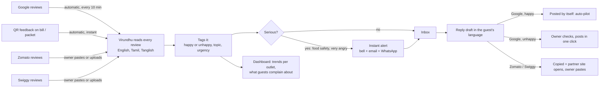

# Virundhu - Every guest, heard

Review intelligence for Tamil Nadu restaurants and cloud kitchens. Every review (English, Tamil, Tanglish) is read
automatically: happy or unhappy, what it's about, how urgent, and a reply draft in the guest's language. Serious
complaints raise an instant alert.

**Run it:** `bash start.sh` → http://localhost:5450 (API on 8450). Full steps: **GETTING_STARTED.md**.
**Admin login:** `admin@virundhu.local` / `Virundhu@Admin2026`

---

## The real scenario

Karthik owns a biryani brand with 3 outlets in Coimbatore. Every day his outlets get reviews in three places:

- **Zomato** and **Swiggy**: after a delivery, the guest rates the order and writes a comment. It goes to the
  restaurant's partner app, one outlet at a time.
- **Google Maps**: walk-in guests and people searching "biryani near me" read and write reviews here.

What happens today without Virundhu:

1. Karthik or his manager has to open 3 apps × 3 outlets to see what guests said. Usually nobody does it every day.
2. Reviews in Tamil or Tanglish ("biryani semma, but delivery romba late") are skimmed or missed.
3. A serious complaint ("found a hair", "family vomited after eating") sits unseen for days. By then the guest has
   posted it on Instagram or complained to the food-safety department.
4. Most reviews never get a reply, so future guests see an owner who doesn't care.
5. Nobody knows whether the problem is the food, the delivery time or the packaging, or which outlet it is.

## What Virundhu does

Step by step, for one review:

1. A guest writes on Zomato: *"Ordered at 8, came at 9:15, biryani fully cold. Very bad."*
2. The review gets into Virundhu (Google: by itself; Zomato/Swiggy: the owner pastes it or uploads the day's reviews).
3. Within a minute Virundhu marks it: **unhappy · delivery · reply today**, with a one-line summary.
4. If it's serious (food safety, a very angry guest), the owner gets an **alert straight away** on the bell and by email.
5. In the **Inbox** a polite reply is already written in the guest's language. The owner edits it if needed.
6. One click: posted on Google, or copied with Zomato/Swiggy's partner site opened to paste it.
7. The **Dashboard** shows the week: how many reviews, % happy, average rating, top complaints, which outlet is
   slipping.
8. **Ask Virundhu** (chat): the owner asks in plain words, in English, Tamil or Tanglish, for example *"What should I fix
   first this week?"*, and gets **Priority 1, 2 and 3**, each with the evidence and one action. Virundhu counts the
   numbers itself; the AI only explains and ranks them.

## Why a restaurant pays for it

| Without Virundhu | With Virundhu |
|---|---|
| 3 apps × every outlet, checked when someone remembers | One inbox for all outlets and all platforms |
| Tamil and Tanglish reviews skimmed | Every review read and summarised in English |
| Food-safety complaints found days later | Alert in about a minute, so the owner can call the outlet the same day |
| Replies take time, so most reviews get none | Reply drafts ready; Google replies posted in one click |
| "Sales are down" with no idea why | Complaint trends per outlet: delivery, taste, packaging, staff, price |
| No time to study reports | Ask "what do I fix first?" and get priority 1, 2, 3 |
| Owner has to be on every app | Owner sees everything in one place, on the phone too |
| Only Zomato/Swiggy guests' opinions, kept inside Zomato/Swiggy | Own QR feedback from every guest (dine-in, takeaway, delivery), owned by the restaurant |
| Thank-you replies typed one by one | Happy Google reviews answered automatically |

In one line for the pitch: **"Never miss a serious complaint again, and reply to every guest in their own language
in seconds."**

## Can Virundhu connect to Zomato and Swiggy directly?

Not today, and no other product can do it honestly either:

- Zomato and Swiggy don't offer outside software any way to read reviews or post replies. Their partner connections
  (used by billing software like Petpooja) cover orders and menus only.
- Tools that claim to do it copy the reviews off the website without permission. That breaks Zomato's and Swiggy's
  rules and can put the restaurant's listing at risk. Virundhu doesn't do that.
- **Google is fully automatic** (reviews in, replies out), and Google is where new guests decide where to eat.
- For Zomato and Swiggy the owner pastes or uploads reviews, and replies with one click + paste.
- If Zomato or Swiggy ever give review access to approved partners, Virundhu can connect the same way Google does.

Say this upfront when you pitch. Restaurant owners know these apps well, and being honest builds trust.

## How to pitch it (10 minutes)

1. **Ask:** "How many apps do you check for reviews, and how often? When did you last miss a bad one?"
2. **Show the problem:** pull up one of their real 1-star Zomato or Google reviews that never got a reply.
3. **Live demo:** register their restaurant on your link, upload or paste 10 of their real reviews, and show the
   dashboard, the urgent ones on top, and a Tamil reply draft.
4. **Connect Google** in front of them, so their Google reviews start flowing in.
5. **Price:** 14-day free trial, then a price per outlet that drops as the chain grows (₹1,499 for one outlet down to
   ₹649 per outlet for 51+), with 5–15% off for 3–12 months and 1–2 free months on 9 and 12 months. Open the
   Pricing page calculator together and type their outlet count. Code **FIRST10** = 20% off for the first 10 customers.
6. **Close:** "Try it free for 14 days. If it doesn't catch one complaint you would have missed, don't pay."

## Using it, step by step

**You (admin)**
1. Run `bash start.sh` (on the VPS later, it's your website address).
2. Sign in with `admin@virundhu.local` / `Virundhu@Admin2026`. You see every restaurant, their plan, trial days, review
   counts per platform and money collected.
3. Click **Open** on a restaurant to see exactly what the owner sees.

**A restaurant owner**
1. Opens your link → **Start free trial** → name, restaurant name, city, email, password (or Continue with Google).
2. **Connections** → **Connect Google** (once).
3. **Automation** → turn on auto-pilot, download the QR code and print it on bills/packets, add WhatsApp numbers.
4. **Add reviews** → paste Zomato/Swiggy reviews, or upload the Excel/CSV.
5. **Inbox** → urgent ones first → edit the reply → post on Google, or copy to Zomato/Swiggy → **Mark as replied**.
6. **Dashboard** → see how guests felt this week, per outlet.
7. **Ask Virundhu** → "What should I fix first?" for priority 1, 2 and 3.
8. **Plan and billing** → pay before the 14-day trial ends (UPI or card through Dodo Payments).

## Status (16 Nov 2026)

| Area | State |
|---|---|
| Public website: Home, How it works, Why Virundhu, Pricing, Contact (interactive story, before/after, calculator) | Done |
| Privacy Policy, Terms, Refunds, Security pages; consent at sign-up; forgot/change password; export and delete account | Done (have a lawyer review the legal pages) |
| Two roles: platform admin + restaurant owner | Done |
| Owner sign-up (email or Google), 14-day trial | Done |
| Dashboard, inbox with reply drafts, instant alerts (bell + email) | Done |
| Review intake: Google live sync, paste, CSV/Excel upload | Done |
| Post replies back to Google | Done (needs Google's Business Profile API approval) |
| Zomato / Swiggy | Not live: no public review API. Owner pastes reviews; reply is copied and their partner site opens |
| AI | One provider at a time (`LLM_PROVIDER`). Currently OpenAI `gpt-4.1-mini` |
| Payments | Dodo Payments, test mode. 4 INR products, launch code FIRST10 (20% off, first 10 customers). Razorpay kept as an alternative |
| Ask Virundhu (chat) | Done: questions about the last 30 days, priorities 1-2-3 |
| Google auto-pilot | Done: happy Google reviews (4-5★ or 5★ only) get the reply posted by itself |
| Own QR feedback link | Done: guests rate the food from a QR on the bill or packet; lands in Virundhu automatically, then every guest is invited to Google |
| WhatsApp alerts | Built, switched off until a WhatsApp Business (Meta Cloud API) account is added |
| Admin console | All restaurants, plans, trials, review counts per platform, money collected, AI cost, demo requests from the Contact page |
| Deploy to VPS, GitHub push | Waiting for owner approval |

## What is in this folder

| File / folder | Purpose |
|---|---|
| `GETTING_STARTED.md` | Step-by-step: install, keys, run, test as owner, test a payment, admin view, fixes |
| `HOW_IT_WORKS.md` | One page: who sees what, where reviews come from |
| `CHANGELOG.md` | What changed and why |
| `TEST_REPORT.md` | What's built, what isn't, and every test with its result |
| `LAUNCH_GUIDE.md` | A restaurant owner's journey step by step, your go-live checklist, security status, trust ideas |
| `INITIAL.md` | Original product definition (read its "Current decisions" section first) |
| `CLAUDE.md` | Rules Claude Code follows while building |
| `PRPs/virundhu-prp.md` | Build blueprint (read its "Current decisions" section first) |
| `skills/` | Backend, frontend, database, AI pipeline, testing, deployment guides |
| `agents/` | Orchestrator and specialist agent definitions |
| `claude-commands/` | `/generate-prp`, `/execute-prp`, `/setup-project` (copy into `.claude/commands/`) |
| `deploy/github-ci.yml` | CI workflow (move to `.github/workflows/ci.yml` when pushing) |
| `samples/` | `virundhu_sample_reviews.xlsx` (15 test reviews) and `reviews_week40.csv` |
| `.env.example` | Every setting, with where it comes from. Real values go only in `.env` |

## Rules

- Nothing is pushed to GitHub or deployed to the VPS without the owner's approval.
- Keys live only in `.env`, which is in `.gitignore`.

## Pricing (worked out automatically)

The owner picks how many outlets and how many months; the price is calculated. The table lives in one file,
`backend/app/services/pricing.py`, and the website, billing page, Dodo checkout and payment checks all use it.

| Outlets | Price per outlet per month |
|---|---|
| 1 | ₹1,499 |
| 2–5 | ₹1,199 |
| 6–20 | ₹949 |
| 21–50 | ₹799 |
| 51+ (up to 500 online; more = talk to us) | ₹649 |

| Pay for | Discount | Free months added |
|---|---|---|
| 1 month | none | none |
| 3 months | 5% | none |
| 6 months | 10% | none |
| 9 months | 10% | +1 (10 months of use) |
| 12 months | 15% | +2 (14 months of use) |

Examples: 1 outlet for 12 months = ₹15,290 (14 months of use). 12 outlets for 12 months = ₹1,16,158.
100 outlets for 12 months = ₹6,61,980 (₹473 per outlet per month). Prices include GST.
