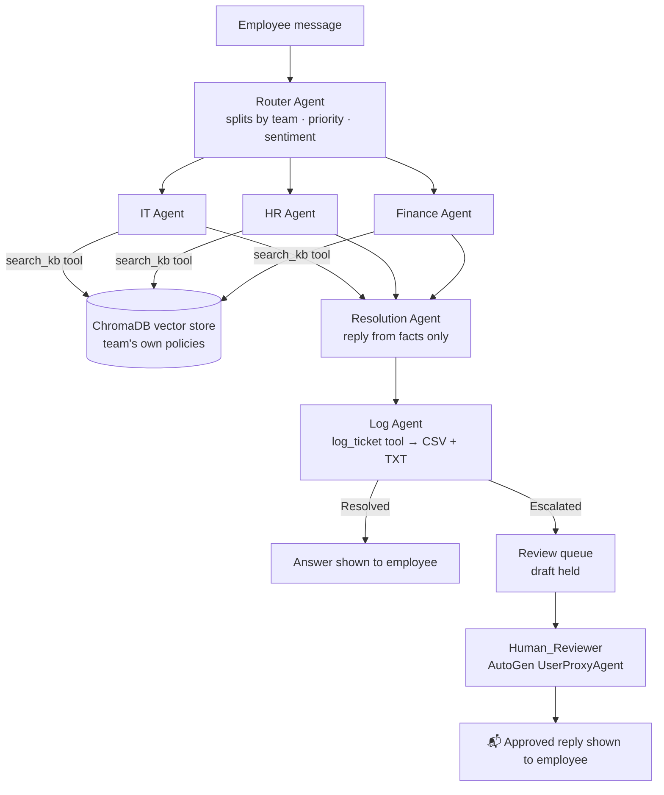

# 🎧 SK Soft Technology AI Help Desk

**A multi-agent support desk built with AutoGen, ChromaDB and human-in-the-loop review.**

Employees of SK Soft Technology (an IT services company) ask any question in one chat. A Router Agent
splits the message by team, each team's agent answers **only from that team's company policies**,
and sensitive cases are **approved by a person** before the employee sees them. Every question is logged as a ticket.

| | |
|---|---|
| 🌐 **Live app** | https://helpdesk.sathishsakthivel.tech |
| 💻 **Source code** | https://github.com/sathishvarun/SE-B12/tree/main/Week5/smart-helpdesk-agents |
| 🏁 **Built for** | Social Eagle AI Engineering Program — Hackathon, Multi-Agent Systems track ("AI Customer Support Automation") |

---

## Contents
1. [Why this project](#1-why-this-project)
2. [Features](#2-features)
3. [How it works](#3-how-it-works)
4. [The agents](#4-the-agents)
5. [Concepts used](#5-concepts-used)
6. [Tech stack and models](#6-tech-stack-and-models)
7. [Screenshots](#7-screenshots)
8. [Project structure](#8-project-structure)
9. [Run it on your computer](#9-run-it-on-your-computer)
10. [Configuration (.env)](#10-configuration-env)
11. [Deploy on a VPS with Docker and HTTPS](#11-deploy-on-a-vps-with-docker-and-https)
12. [Ticket log format](#12-ticket-log-format)
13. [Challenges faced and how they were solved](#13-challenges-faced-and-how-they-were-solved)
14. [Assignment checklist](#14-assignment-checklist)
15. [Future enhancements](#15-future-enhancements)

---

## 1. Why this project

In a growing IT company, employees lose time finding the right team for each question (laptop setup, leave,
payroll, client invoices, RFPs…), and support teams answer the same questions again and again.

This help desk gives everyone **one place to ask**:
- **Employees** get instant answers from official company policy, in plain words.
- **Support teams** only handle the cases that really need a person — and get an AI draft ready to approve.
- **Managers** see every ticket by team, priority and outcome, with a weekly summary.

## 2. Features

- 🧭 **One message, many teams** — "What software do I install, what documents does HR need, and what does
  Finance need for payroll?" becomes three tickets: **IT, HR and Finance**, each answered by its own agent.
- 📚 **Answers grounded in company policy** — six knowledge folders (Client Support, Finance, Marketing, Sales, HR, IT).
- 🔎 **Vector search with ChromaDB** — questions are matched **by meaning**, not exact words.
- 🙋 **Automatic escalation** — high priority, angry, legal/fraud/payment-dispute/harassment, no matching policy, or low confidence.
- 🧑‍💼 **Human-in-the-loop review** — escalated replies are held until a staff member edits and approves them.
- 📬 **Replies from our team** — employees see approved answers next to their chat.
- 🪪 **Mandatory name and Employee ID**, saved on every ticket.
- 💡 **One-tap example questions** per team, including multi-team "New Joiner" examples.
- 🗂️ **Ticket history** with search, filters and Excel / CSV / TXT download.
- 📊 **Weekly summary** — tickets per team, solved vs escalated, tickets per day, weekly TXT report.
- 🙈 **Clean view for employees** — no file names or agent internals; `SHOW_AGENT_STEPS=true` shows them for demos.
- 🌍 **Fixed reply language** (English by default) so the model never drifts into another language.
- 🚀 **Production deploy** — Docker container behind Traefik with a free Let's Encrypt certificate, on a shared VPS.

## 3. How it works



Step by step:
1. The employee signs in with **name + Employee ID**, then types a question or taps an example.
2. The **Router Agent** splits the message into one request per team (max 4) and sets each request's
   **priority** (High / Medium / Low) and the message **sentiment**.
3. For **each request**, an AutoGen `RoundRobinGroupChat` runs **Team Agent → Resolution Agent → Log Agent**.
   It stops when the Log Agent says `LOGGED` (with a 12-message safety limit).
4. The **team agent** calls `search_kb`, which searches only that team's documents in ChromaDB.
5. The **Resolution Agent** writes a short reply using only the facts found. If nothing matched, it says so honestly.
6. The **Log Agent** calls `log_ticket`: the ticket is saved, the escalation rules run, and only source files
   that `search_kb` really returned are accepted.
7. **Resolved** → the employee sees the answer. **Escalated** → the draft waits in the **Review queue**; a staff
   member approves or edits it, and the employee sees the final reply under **📬 Replies from our team**.

### Escalation rules (any one is enough)
| Rule | Example |
|---|---|
| Priority is **High** | Production outage (P1), money charged wrongly |
| Sentiment is **Angry** | "Fix this NOW!" |
| No matching policy document | A topic the company documents don't cover |
| Legal / fraud / payment dispute / harassment words | lawyer, chargeback, hacked, harass |
| Answer confidence is **Low** | Facts only partly answer the question |
| The Log Agent decides a person is needed | Its own judgement |

## 4. The agents

| Agent | Type | Job | Tools |
|---|---|---|---|
| **Router_Agent** (main) | `AssistantAgent` | Splits the message by team; sets priority and sentiment | — |
| **Client_Support_Agent**, **Finance_Agent**, **Marketing_Agent**, **Sales_Agent**, **HR_Agent**, **IT_Agent** | `AssistantAgent` | Finds the facts in its own team's documents and lists the sources | `search_kb`, optional `web_search` (SerpAPI) |
| **Resolution_Agent** | `AssistantAgent` | Writes the reply using only those facts, plus a confidence level | — |
| **Log_Agent** | `AssistantAgent` | Saves the ticket and decides Resolved / Escalated | `log_ticket` |
| **Human_Reviewer** | `UserProxyAgent` | Brings a real person's approval into the workflow | input from the Review queue page |

## 5. Concepts used

- **Multi-agent design** — each agent has one job and its own system message.
- **Routing and query splitting** — one message → one request per team.
- **Agent orchestration** — `RoundRobinGroupChat` with `TextMentionTermination("LOGGED")` + `MaxMessageTermination(12)`.
- **Tool calling** — agents call Python functions (`search_kb`, `log_ticket`, `web_search`).
- **RAG (Retrieval-Augmented Generation)** — answers come only from retrieved policy passages.
- **Vector search** — OpenAI embeddings stored in ChromaDB; cosine distance ≤ 0.75 counts as relevant; the index
  rebuilds automatically when a document changes; keyword search is the automatic fallback.
- **Anti-hallucination checks** — made-up source file names are rejected; "no information" is said honestly.
- **Rule-based escalation** and **human-in-the-loop** review with AutoGen's `UserProxyAgent`.
- **Logging and reporting** — one row per ticket, weekly summary.
- **Secrets management** — keys only in `.env`, kept out of Git and Docker images.
- **Containerised deployment behind a reverse proxy** — Docker + Traefik + Let's Encrypt.

## 6. Tech stack and models

| Layer | Tool |
|---|---|
| Agents | AutoGen 0.7.5 (`autogen-agentchat`, `autogen-ext[openai]`) |
| LLM | OpenAI **`gpt-4o-mini`** (temperature 0.2) — all reasoning agents |
| Embeddings | OpenAI **`text-embedding-3-small`** |
| Vector store | **ChromaDB** (local, persistent) |
| Web search (optional) | SerpAPI |
| UI | Streamlit 1.45+ |
| Data and logs | pandas, csv, openpyxl (Excel export) |
| Language | Python 3.10+ |
| Code and versioning | VS Code, Git, GitHub |
| Hosting | Hostinger VPS (Ubuntu 24.04), Docker |
| HTTPS and domain | Traefik, Let's Encrypt, Hostinger DNS |

## 7. Screenshots

| | |
|---|---|
| **Sign in (name + Employee ID)**  | **Ask page with one-tap team examples**  |
| **One question answered by three teams**  | **Escalated: waiting for a person**  |
| **Review queue (human-in-the-loop)**  | **Employee sees the approved reply**  |
| **Ticket history and log**  | **Weekly summary**  |

## 8. Project structure

```
smart-helpdesk-agents/
├── app.py                        # Streamlit UI: Ask, Ticket history, Weekly summary, Review queue
├── team.py                       # Router → (Team agent → Resolution → Log) for each team
├── config.py                     # Settings from .env: model, departments, search, passwords
├── helpdesk_app.py               # The whole app in ONE file (optional, for quick demos)
├── agents/
│   ├── router_agent.py           # Main agent: splits the message by team
│   ├── department_agents.py      # Six team agents + search_kb tool
│   ├── resolution_agent.py       # Writes the grounded reply
│   ├── log_agent.py              # log_ticket tool + escalation decision
│   └── human_review_agent.py     # UserProxyAgent for human-in-the-loop approval
├── tools/
│   ├── vector_store.py           # ChromaDB + OpenAI embeddings
│   ├── kb_search.py              # Vector search with keyword fallback
│   ├── ticket_store.py           # CSV/TXT logging, escalation rules, review updates
│   └── web_search.py             # Optional SerpAPI search
├── knowledge_base/               # Company policies, one folder per team
│   ├── customer_support/  finance/  marketing/  sales/  hr/  it/
├── deploy/
│   ├── connect_domain_traefik.sh # Docker + Traefik + HTTPS on a VPS that already runs Traefik
│   ├── setup_vps.sh              # Plain VPS setup (Nginx or direct port)
│   ├── nginx.conf, smart-helpdesk.service
├── Dockerfile, docker-compose.yml, .dockerignore
├── DEPLOY_VPS.md                 # Step-by-step VPS guide
├── screenshots/                  # Images used in this README
├── logs/                         # tickets.csv + tickets.txt (created automatically, not in Git)
├── .env.example, .gitignore, requirements.txt
```

## 9. Run it on your computer

```bash
# 1. Get the code
git clone https://github.com/sathishvarun/SE-B12.git
cd SE-B12/Week5/smart-helpdesk-agents

# 2. Virtual environment + packages (Python 3.10+)
python3 -m venv .venv
source .venv/bin/activate            # Windows: .venv\Scripts\activate
pip install -r requirements.txt

# 3. Settings
cp .env.example .env                 # then add OPENAI_API_KEY and REVIEWER_PASSWORD

# 4. Run
streamlit run app.py                 # opens http://localhost:8501
```
Port 8501 busy? `streamlit run app.py --server.port 8502`. Quick terminal test without the UI: `python team.py`.

**Try it**
1. Sign in with a name and Employee ID.
2. Tap **🚀 New Joiner → Day-1: software + documents + payroll** → three team answers.
3. Type *"The client says invoice INV-2291 was charged twice. Fix this now or their legal team will get involved."* → escalated.
4. Open **🧑‍💼 Review queue**, sign in with `REVIEWER_PASSWORD`, edit and approve.
5. Back on **💬 Ask**, click **🔄 Check for new replies**.

## 10. Configuration (.env)

| Setting | Required | Default | What it does |
|---|---|---|---|
| `OPENAI_API_KEY` | ✅ | — | OpenAI key for the agents and embeddings |
| `OPENAI_MODEL` | | `gpt-4o-mini` | Model used by all agents |
| `REVIEWER_PASSWORD` | for review | empty (page locked) | Password for the staff Review queue |
| `SEARCH_MODE` | | `vector` | `vector` (ChromaDB) or `keyword` |
| `EMBEDDING_MODEL` | | `text-embedding-3-small` | Embedding model for vector search |
| `REPLY_LANGUAGE` | | `English` | Language of every reply |
| `SHOW_AGENT_STEPS` | | `false` | `true` shows sources and each agent's step (demos) |
| `APP_PASSWORD` | | empty | Optional password for the whole app |
| `SERPAPI_API_KEY` | | empty | Optional web search for public facts |
| `OPENAI_BASE_URL` | | empty | Use another OpenAI-compatible provider (Groq, Ollama…) |

⚠️ Never commit `.env`. It is already listed in `.gitignore` and `.dockerignore`.

## 11. Deploy on a VPS with Docker and HTTPS

The live app runs on a Hostinger VPS that already hosts other apps behind **Traefik**. One script handles it:

```bash
# On the VPS (first time)
git clone --depth 1 https://github.com/sathishvarun/SE-B12.git ~/SE-B12
cd ~/SE-B12/Week5/smart-helpdesk-agents
nano .env                                             # add your keys
bash deploy/connect_domain_traefik.sh helpdesk.yourdomain.com

# Updates later
cd ~/SE-B12 && git pull && cd Week5/smart-helpdesk-agents
bash deploy/connect_domain_traefik.sh helpdesk.yourdomain.com
```
The script reads the existing Traefik setup (network, entrypoint, certificate resolver), builds the Docker image,
starts the `smart-helpdesk` container with Traefik labels for the domain, picks a free port, and gets a Let's Encrypt
certificate. Other apps on the server are not touched.

DNS: add an **A record** `helpdesk` → your VPS IP (letters and hyphens only — no underscores).
No Traefik on your VPS? Use `bash deploy/setup_vps.sh` instead. Full guide: [DEPLOY_VPS.md](DEPLOY_VPS.md).

| Useful commands (VPS) | |
|---|---|
| `docker logs -f smart-helpdesk` | Live logs |
| `docker restart smart-helpdesk` | Restart after editing `.env` |
| `docker stop smart-helpdesk` / `docker start smart-helpdesk` | Stop / start |

## 12. Ticket log format

Every request becomes one row in `logs/tickets.csv` (plus a readable entry in `logs/tickets.txt`):

`ticket_id, timestamp, employee_name, employee_id, department, category, priority, sentiment, summary,
complaint, kb_sources, response, confidence, status, escalation_reason, assigned_to,
review_status, reviewer, final_response, reviewed_at`

Example: `TKT-0004 · Finance · High · Angry · Escalated · "High priority + Involves legal threat" · Approved by Anitha (Finance)`

## 13. Challenges faced and how they were solved

| Challenge | Cause | Solution |
|---|---|---|
| A question for 3 teams was answered only by HR | Router picked a single team | Router splits the message; one team agent and one ticket per part |
| "No information" for laptop setup and payroll | Policies were missing | Added new-joiner setup (IT), joining documents (HR), payroll details (Finance) |
| The Finance answer came back in Spanish | Prompt said "reply in the user's language"; the model guessed wrong | Fixed reply language (`REPLY_LANGUAGE=English`) in every agent prompt |
| Keyword search missed differently worded questions | Exact-word matching | ChromaDB vector search with embeddings; keyword search as fallback |
| `chromadb` and AutoGen clashed on `protobuf` | Packages installed one by one | Clean install resolves both; the app falls back to keyword search if ChromaDB fails |
| Employees saw file names under answers | Debug info shown to everyone | Hidden by default; `SHOW_AGENT_STEPS=true` for demos |
| Review queue rejected the password | `echo >> .env` glued the setting onto the last line | Setting rewritten on its own line; login ignores stray spaces |
| `Port 8501 is not available` | Another Streamlit app was running | Use another port |
| Nginx could not start on port 80 | Traefik already owned 80/443 | Detect the port owner and leave it alone |
| Help desk link opened a different app | Port 8502 belonged to another container | Script picks a truly free port (8510+) |
| `ERR_CERT_AUTHORITY_INVALID` | Traefik had no route for the domain | Docker container with Traefik labels → Let's Encrypt certificate |
| `Port 8501 is not available` inside the container | Traefik in host network mode was copied | App runs on Docker's bridge network instead |
| DNS name `SK_Soft_Support` rejected | Underscores aren't allowed in host names | Used `helpdesk` |
| Copying files with `rsync` failed | Command was run on the VPS, not the Mac | Switched to GitHub: push from Mac, pull on VPS |

## 14. Assignment checklist

| Requirement | Where |
|---|---|
| Four AutoGen agents with clear jobs (Query, Knowledge, Resolution, Log) | Router (Query), six team agents (Knowledge), Resolution, Log — `agents/` |
| Knowledge Agent answers from documents and shows the source file | `search_kb` in `agents/department_agents.py`; sources in the log (and on screen with `SHOW_AGENT_STEPS=true`) |
| No invented policies | Resolution prompt + source verification in `log_ticket` |
| Order Query → Knowledge → Resolution → Log, clean termination | `team.py` |
| Escalation rule, `Escalated` status with reason | `tools/ticket_store.py → escalation_check` |
| Log file with all required columns | `logs/tickets.csv`, `logs/tickets.txt`, Excel download |
| Streamlit UI: steps, badges, log viewer | `app.py` |
| No secrets in GitHub | `.gitignore`, `.dockerignore`, `.env.example` |
| **Bonus:** embeddings + vector store | ChromaDB — `tools/vector_store.py` |
| **Bonus:** human-in-the-loop with `UserProxyAgent` | `agents/human_review_agent.py` + Review queue page |
| **Bonus:** dashboard | Weekly summary page |
| **Bonus:** deployment | Docker + Traefik + HTTPS on a VPS |

## 15. Future enhancements

1. Slack / Teams / email notifications when a ticket is escalated or approved.
2. Company single sign-on (Microsoft / Google) and role-based access for reviewers.
3. Learn from reviewers' edits to improve the AI drafts.
4. PostgreSQL instead of CSV for many users and full audit history.
5. Live data tools (leave balance, payslip status, Jira ticket status).
6. An admin page to upload or edit policy documents.
7. A language picker for employees (English stays the default).
8. Answer ratings and a quality dashboard per team.
9. Automated evaluation tests: fixed questions with expected teams and answers.

---

Built by **Sathish** for the Social Eagle AI Engineering Program hackathon.
