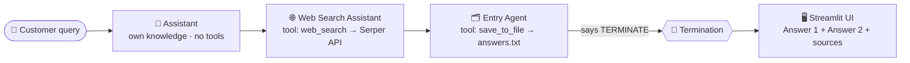

# 🎧 AI Customer Support Desk — Multi-Agent System (AutoGen + Streamlit)

> **Social Eagle · Gen AI Architect Program · Weekly Buildathon (Week 5)**
> A customer support system where three AI agents work one after another: one answers from its own knowledge, one searches the live web, and one records the ticket and returns both answers to the customer.

🔗 **Live demo:** https://support.sathishsakthivel.tech
📂 **Code:** `Week5/support-desk-project/app.py` (single-file app, as required by the brief)

---

## 📌 What it does

1. A customer types a question (for example, *"How do I reset my password?"*).
2. **Agent 1 – Assistant** answers directly from the model's own knowledge.
3. **Agent 2 – Web Search Assistant** searches Google (via Serper), reads the results and writes an answer with source links.
4. **Agent 3 – Entry Agent** saves the ticket, the query and both answers into `answers.txt`, then signals the team to stop.
5. The Streamlit UI shows both answers side by side, along with the sources, ticket details and history.



---

## ✨ Features (beyond the basic brief)

| Area | Feature |
|---|---|
| **Live progress** | Real-time status panel that shows each agent finishing and each tool call, using `run_stream()` |
| **Settings** | Choose the model (gpt-4o-mini / gpt-4o / gpt-4.1…), the temperature, the number of web results, and the answer tone (Friendly, Professional, Concise or Step-by-step) |
| **Ticketing** | Unique ticket ID (`TKT-XXXXXX`) plus customer name, category and priority attached to every query |
| **Answers** | Assistant and Web Search answers shown side by side, with clickable web sources |
| **Quick start** | One-click sample questions |
| **Feedback** | 👍 / 👎 buttons stored per ticket |
| **Export** | Download a single ticket transcript or the full `answers.txt` |
| **History** | Ticket History tab with keyword search, a category filter, and stats (total tickets, helpful count, average response time) |
| **Transparency** | "Agent activity" panel showing tool calls, the stop reason and token usage |
| **Explainer** | "How it works" tab describing the architecture, useful for demos |

---

## 🧠 Concepts used

| Concept | How it is used here |
|---|---|
| **Multi-agent orchestration** | Three specialised agents, each with one job and its own `system_message` |
| **Sequential team (`RoundRobinGroupChat`)** | Agents speak in a fixed order: Assistant → Web Search → Entry. All agents share the conversation history, so the Entry Agent can read both earlier answers. |
| **Tool / function calling** | Plain Python functions (`web_search`, `save_to_file`) passed via `tools=[...]`. Each tool is given **only** to the agent that needs it. |
| **Reflect on tool use** | `reflect_on_tool_use=True` makes the agent read the tool result and write a real answer, instead of returning raw tool output |
| **Termination conditions** | `TextMentionTermination("TERMINATE", sources=["Entry_Agent"]) \| MaxMessageTermination(12)`. The team stops when the Entry Agent says TERMINATE, with a message cap as a safety net so it never loops back to the first agent. |
| **Streaming** | `team.run_stream()` yields each message and event as it happens, which drives the live progress UI |
| **Async ↔ sync bridge** | AutoGen is async and Streamlit is sync, so `asyncio.run(...)` runs the team from a Streamlit button |
| **Grounded answers (light RAG)** | The web agent answers **only** from the search results and cites its sources |
| **Prompt engineering** | Role-specific system prompts, tone control, and rules that keep the stop word away from other agents |
| **Secrets management** | API keys are read from environment variables or `.env`, never hard-coded, and `.env` is excluded by `.gitignore` |
| **Containerised deployment** | Docker container behind a Traefik reverse proxy with automatic HTTPS (Let's Encrypt) |

---

## 🛠️ Tech stack & tools

| Tool | Purpose |
|---|---|
| **Python 3.10+** | Language |
| **Microsoft AutoGen – AgentChat 0.7** (`autogen-agentchat`, `autogen-ext[openai]`) | Agents, team, tools, termination |
| **OpenAI API** (`OpenAIChatCompletionClient`) | LLM behind every agent |
| **Serper.dev API** | Google search results for the web agent |
| **Streamlit** | Web UI |
| **requests** | HTTP calls to Serper |
| **python-dotenv** | Loads keys from `.env` |
| **VS Code + macOS Terminal** | Development |
| **Git & GitHub** | Version control and submission |
| **Hostinger VPS (Ubuntu 24.04)** | Hosting |
| **Docker + Docker Compose** | Runs the app in an isolated container |
| **Traefik** | Reverse proxy with automatic HTTPS for the subdomain |
| **Hostinger DNS** | `A` record for `support.sathishsakthivel.tech` |

---

## 📁 Project structure

```
support-desk-project/
├── app.py            # Entire app: tools, agents, team, Streamlit UI
├── requirements.txt  # Python dependencies
├── README.md         # This file
├── .env.example      # Template for API keys (copy to .env)
├── .gitignore        # Keeps .env, venvs and generated files out of Git
├── answers.txt       # (generated) Saved by the Entry Agent: query + both answers
└── tickets.jsonl     # (generated) Ticket history and feedback used by the UI
```

---

## 🚀 Run locally (macOS)

```bash
cd support-desk-project
python3 -m venv .venv
source .venv/bin/activate
pip install -r requirements.txt
cp .env.example .env          # then paste your real keys into .env
streamlit run app.py
```
Open **http://localhost:8501**.

**.env**
```
OPENAI_API_KEY=sk-...
SERPER_API_KEY=...
```

---

## 🌐 Deployment (Hostinger VPS · Docker · Traefik · HTTPS)

The VPS already runs other projects (n8n, RAG and search apps) behind a **Traefik** proxy that owns ports 80 and 443. To avoid disturbing them, this app runs as **its own Docker container on its own subdomain**. Traefik discovers it through Docker labels and issues the HTTPS certificate automatically.

1. **DNS:** add an `A` record named `support`, pointing to the VPS IP.
2. **Code:** `git clone` the repo to `/opt/support-desk` and add `.env` with the keys.
3. **Container:** create `compose.yml`:

```yaml
services:
  support-desk:
    image: python:3.12-slim
    container_name: support-desk
    working_dir: /app
    volumes:
      - /opt/support-desk/Week5/support-desk-project:/app
    command: sh -c "pip install -q -r requirements.txt && streamlit run app.py --server.port 8501 --server.address 0.0.0.0 --server.headless true"
    restart: unless-stopped
    networks: [n8n-2fqi_default]
    labels:
      - traefik.enable=true
      - traefik.docker.network=n8n-2fqi_default
      - traefik.http.routers.support-desk.rule=Host(`support.sathishsakthivel.tech`)
      - traefik.http.routers.support-desk.entrypoints=websecure
      - traefik.http.routers.support-desk.tls.certresolver=letsencrypt
      - traefik.http.services.support-desk.loadbalancer.server.port=8501
networks:
  n8n-2fqi_default:
    external: true
```

4. **Start:** run `docker compose up -d`.
5. **Update later:** run `git pull && docker restart support-desk`.

---

## 🧩 Challenges faced & how I solved them

| # | Challenge | Root cause | Fix |
|---|---|---|---|
| 1 | **AutoGen is async, Streamlit is not** | `team.run_stream()` is a coroutine | Wrapped the run in `asyncio.run()`, with a callback that updates `st.status` and `st.progress` live |
| 2 | **Picking the right answers out of the conversation** | The result contains text messages, tool-call events and tool results from all agents | Filtered by message type (`TextMessage`, `ToolCallSummaryMessage`, tool events) and by `source` agent name |
| 3 | **Web agent returned raw search output** | By default an agent returns the tool output as-is | Enabled `reflect_on_tool_use=True` so it writes a proper answer from the results |
| 4 | **Team could loop back to Agent 1** | RoundRobin keeps cycling without a stop rule | `TextMentionTermination` limited to the Entry Agent, plus a `MaxMessageTermination` safety cap |
| 5 | **`streamlit: command not found` on Mac** | Two virtual environments (`venv` created by me, `.venv` auto-created by VS Code); packages went into one while the other was active | Removed the extra venv and activated `.venv` |
| 6 | **`.gitignore` contents pasted into the terminal** | Confusion between file contents and commands | Created the file with a single `cat > .gitignore <<EOF` command |
| 7 | **`git push` failed: "No configured push destination"** | The local folder was a Git repo **not linked** to GitHub | Cloned the GitHub repo fresh, copied only the 5 project files, committed and pushed |
| 8 | **Nginx wouldn't start on the VPS** (`Address already in use`) | Ports 80/443 were already owned by **Traefik** (used by n8n and other apps) | Dropped Nginx/Certbot and used the existing Traefik via Docker labels instead |
| 9 | **Port 8501 conflict** | Another Streamlit project already publishes port 8501 | The app runs on 8501 **inside its own container** and isn't published on the host, so there's no clash |
| 10 | **First deployment used the server hostname and touched shared settings** | Didn't check what was already running on the VPS before deploying | Rolled everything back, verified all existing containers were untouched, and redeployed on a **dedicated subdomain** in an isolated container |
| 11 | **Keeping secrets safe** | API keys must never reach GitHub | `.env` + `.gitignore`, keys loaded with `python-dotenv`, and only 5 named files committed |

**Key lessons**
- Before deploying to a shared server, **inspect what's already running** (`docker ps`, `ss -tlnp`) and reuse the existing reverse proxy instead of adding a new one.
- Use **one subdomain per project** and **one container per app** for clean isolation.
- Always check which machine a terminal is on (Mac vs VPS) and which virtual environment is active.

---

## 🔐 Security notes
- No API keys in the code or the repo. They live only in `.env` (local and VPS).
- The public demo has no login, so set a **monthly spending limit** on the OpenAI account.
- HTTPS is handled by Traefik with Let's Encrypt certificates that renew automatically.

---

## 🔮 Future improvements
- A 4th "Reviewer" agent that compares both answers and writes a final merged reply
- Conversation memory for follow-up questions
- Escalation to a human agent for *Urgent* tickets (email or Slack via n8n)
- Store tickets in a database (SQLite or Postgres) instead of text files
- Analytics dashboard: tickets by category, feedback score, and response time

---

## 👤 Author
**Sathish Varun** · Social Eagle Gen AI Architect Program (Batch B12)
GitHub: [@sathishvarun](https://github.com/sathishvarun)
