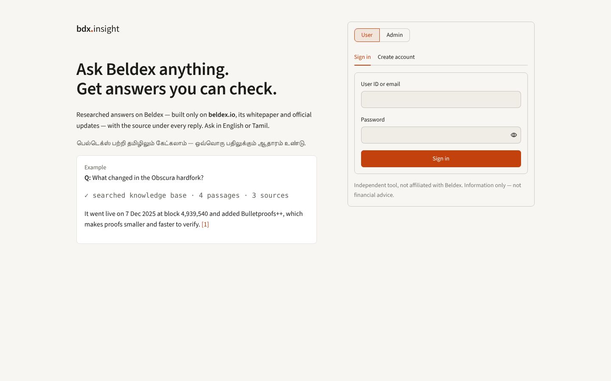
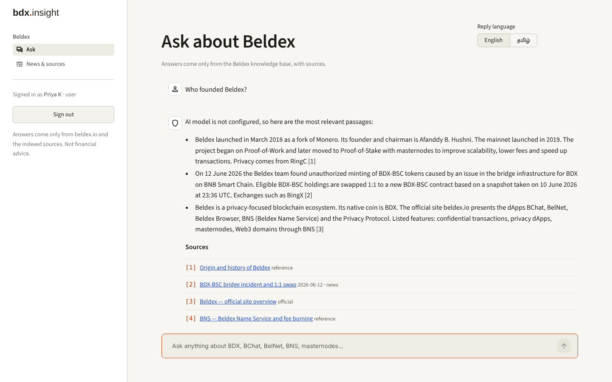
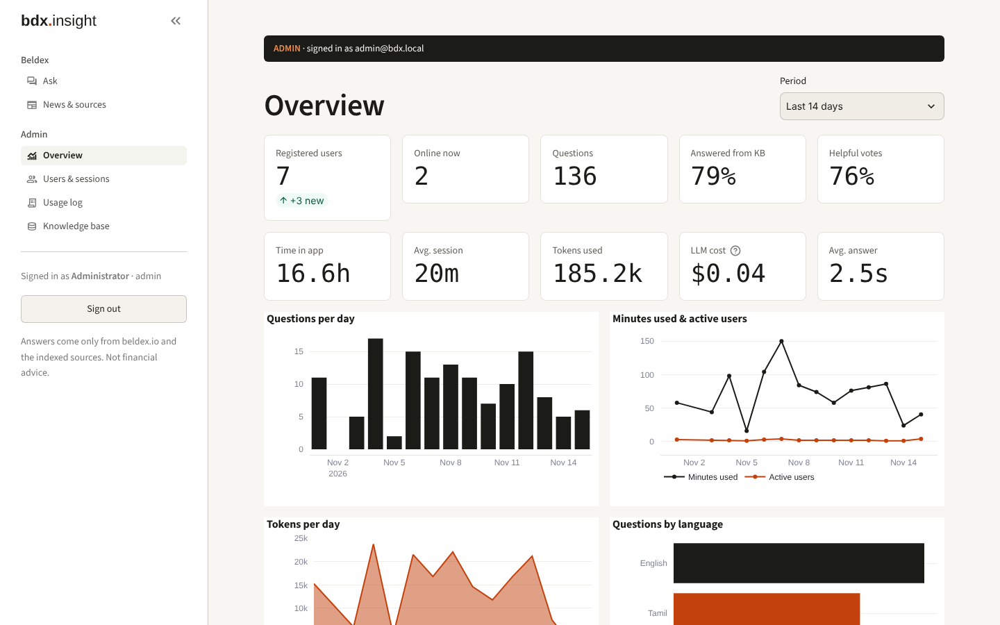
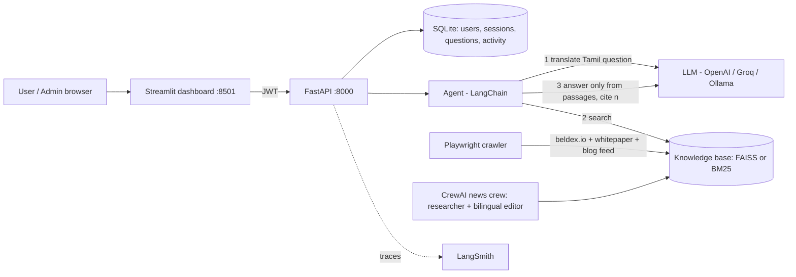

# bdx.insight — bilingual Beldex AI assistant with an admin dashboard

A demo product: people sign in and ask anything about **Beldex (BDX)** in **English or Tamil**. An AI agent answers **only from the Beldex knowledge base** (beldex.io, its whitepaper and official updates) and shows the **source under every answer**. Admins get a separate console that shows who signed in, how long they used it, what they asked and how many resources each question used.



> **தமிழில் சுருக்கம்:** பயனர்கள் login செய்து பெல்டெக்ஸ் பற்றி தமிழிலோ ஆங்கிலத்திலோ எதையும் கேட்கலாம். AI agent beldex.io மற்றும் அதன் whitepaper-இல் உள்ள தகவல்களை மட்டுமே பயன்படுத்தி பதில் சொல்லும்; ஒவ்வொரு பதிலுக்கும் கீழே ஆதாரம் (source link) காட்டும். Admin-க்கு தனி login உண்டு — யார் login செய்தார்கள், எவ்வளவு நேரம் பயன்படுத்தினார்கள், என்ன கேட்டார்கள், எவ்வளவு tokens / CPU / செலவு ஆனது என்பதை எல்லாம் dashboard-இல் பார்க்கலாம்.

---

## What it does

| For users | For admins |
|---|---|
| Sign up / sign in (separate **User** and **Admin** access) | Overview: users, online now, questions, time in app, tokens, cost, answer speed, server CPU/RAM |
| Ask in English or தமிழ் — the reply comes in the chosen language | Users & sessions: every person, every sign-in (IP, device, minutes), every question with its sources |
| Every answer lists numbered sources with links and dates | Usage log: filter by user / language / answered, download CSV |
| "How this answer was made" — the agent's steps | Knowledge base: all sources, one-click refresh (Playwright crawl + re-index + news digest) |
| News & sources page: weekly digest written by an AI crew | Suspend / reactivate users, promote to admin |




---

## How it works



**Staying inside our own knowledge:** the agent may only use the numbered passages it retrieved. If they do not answer the question, it replies "not in the knowledge base" instead of guessing (tested in `tests/test_api.py`). Every answer stores its sources, and admins can see them too.

---

## Which concepts are used, and why

| Concept | Used for | Why this one |
|---|---|---|
| **FastAPI** | Sign-in, the agent endpoint, admin API (`/docs` has the full API) | Fast, typed, auto-documented. The UI and any future mobile app share one backend |
| **Streamlit** | The whole dashboard (user and admin) | Interactive tables, charts and chat in pure Python |
| **LangChain** | Prompts, LLM calls, text splitting, FAISS and BM25 retrievers | Standard RAG building blocks; switching LLM provider is one line in `.env` |
| **Vector DB — FAISS** | Meaning-based search that also matches Tamil questions to English passages | Runs as files in `data/index`, so no extra server is needed. Qdrant is the next step if the data grows |
| **BM25 (keyword search)** | Fallback when no embeddings key is set (and in tests) | The app still works with no paid API |
| **Knowledge RAG** | Answers grounded in retrieved passages, with `[n]` citations | This is what keeps answers inside our own sources |
| **AI agent** | Multi-step flow: translate → search → answer → check the citations | Shown to the user as "How this answer was made" |
| **CrewAI** | News crew: *researcher* + *bilingual editor* write the weekly digest | Two roles fit a simple sequential crew |
| **Playwright** | Crawls beldex.io and its sub-sites like a real browser (JavaScript pages) | The official site renders with JavaScript, so a plain HTTP fetch misses content |
| **LangSmith** | Optional tracing of every LLM call | Debug and cost checks (`LANGSMITH_TRACING=true`) |
| **Docker** | One image runs the API and the dashboard; deploys to the VPS behind Traefik | Same setup as the live Help Desk |
| **SQLAlchemy + SQLite** | Users, sessions, questions, activity, crawl runs | Zero setup. Set `DATABASE_URL` to use Postgres later |
| **bcrypt + JWT** | Password hashing and login tokens with roles | Never stores plain passwords |
| **psutil** | Per-question CPU time and memory; server CPU/RAM/disk | The "resources used" numbers in the admin dashboard |

**Left out on purpose (possible next steps):**
- **AutoGen** — CrewAI already covers the multi-agent part. Running two agent frameworks in one product doubles the maintenance for no user benefit. AutoGen is still showcased in Week 5.
- **Neo4j** — a knowledge graph is useful once there are hundreds of linked entities. Here FAISS plus sources is simpler and enough.
- **SLM builder / fine-tuning** — a small fine-tuned model would need a training set first. For privacy or zero cost, point `OPENAI_BASE_URL` at local **Ollama** instead.

---

## Project structure

```
bdx-insight-ai/
├── app/
│   ├── api.py              # FastAPI: auth, /chat, admin endpoints
│   ├── db.py               # tables: users, sessions, queries, activity, knowledge_runs
│   ├── security.py         # bcrypt + JWT, user/admin guards
│   ├── metrics.py          # latency, CPU time, memory per question; server snapshot
│   ├── config.py           # reads .env
│   ├── rag/
│   │   ├── seed_knowledge.json   # starter facts (each with its source URL)
│   │   ├── knowledge.py    # load → split → FAISS / BM25 index
│   │   ├── chain.py        # the agent (translate → retrieve → grounded answer)
│   │   ├── crawler.py      # Playwright crawler for beldex.io + blog feed
│   │   └── llm.py          # LangChain model + embeddings factory
│   └── agents/news_crew.py # CrewAI researcher + bilingual editor
├── ui/                     # Streamlit dashboard (app.py, pages_user.py, pages_admin.py, theme)
├── scripts/seed_demo.py    # optional demo users and usage for presentations
├── tests/test_api.py       # pytest: sign-up, grounding, role checks, suspend, logout
├── deploy/connect_domain_traefik.sh   # VPS + Traefik + HTTPS in one command
├── Dockerfile, docker-compose.yml, start.sh
└── .env.example
```

---

## Run it on your Mac (VS Code) — step by step

**1. Get the code.** Open VS Code → **Terminal → New Terminal**, then:
```bash
cd ~/SE-B12-repo            # your local copy of the SE-B12 repo
git pull                     # brings in the bdx-insight-ai folder
cd bdx-insight-ai
code .                       # opens this project in VS Code (optional)
```

**2. Create and activate a virtual environment.**
```bash
python3 -m venv .venv
source .venv/bin/activate    # your prompt now starts with (.venv)
```
In VS Code press `Cmd+Shift+P` → **Python: Select Interpreter** → pick `.venv`.

**3. Install the packages** (3–6 minutes the first time).
```bash
pip install --upgrade pip
pip install -r requirements.txt
playwright install chromium   # the browser the crawler uses
```

**4. Create your `.env` and paste your keys.**
```bash
cp .env.example .env
python3 -c "import secrets; print(secrets.token_hex(32))"   # copy the long text it prints
```
Open `.env` in VS Code and fill in:
- `OPENAI_API_KEY=` → your key from https://platform.openai.com/api-keys
- `JWT_SECRET=` → the long text you just printed
- `ADMIN_EMAIL=` and `ADMIN_PASSWORD=` → your admin login (it is created on the first start)

No OpenAI key yet? Leave it empty. The app still runs and shows the best matching passages (with sources) instead of written answers.

**5. Start the app.**
```bash
bash start.sh
```
Open **http://localhost:8501**. API docs: **http://127.0.0.1:8000/docs**. Stop with `Ctrl+C`.

**6. First things to do.**
1. Click **Admin**, sign in with your `ADMIN_EMAIL` / `ADMIN_PASSWORD`.
2. Go to **Knowledge base → Refresh knowledge**. Playwright reads beldex.io and the whitepaper (2–5 minutes) and the news crew writes the digest.
3. Sign out, choose **User → Create account**, and ask a question in Tamil.
4. *(Optional, for a sales demo)* `python scripts/seed_demo.py` adds 6 demo users with usage history. Remove them with `python scripts/seed_demo.py --clear`.

**7. Run the tests.**
```bash
pytest -q
```

**Or with Docker:** `docker compose up --build` → http://localhost:8501

---

## Put it live and share the link (Hostinger VPS with Traefik)

1. **DNS:** in your domain panel add an **A record**: Name `bdx` → Value `YOUR_VPS_IP`.
2. **Copy the project to the VPS** (from your Mac):
   ```bash
   rsync -avz --exclude '.venv' --exclude '__pycache__' --exclude 'data' --exclude '.DS_Store' \
     ~/SE-B12-repo/bdx-insight-ai/ root@YOUR_VPS_IP:~/bdx-insight-ai/
   ```
   This also copies your `.env` securely over SSH. Use a **strong** `ADMIN_PASSWORD` and a new `JWT_SECRET` for the live server.
3. **On the VPS:**
   ```bash
   ssh root@YOUR_VPS_IP
   cd ~/bdx-insight-ai
   bash deploy/connect_domain_traefik.sh bdx.sathishsakthivel.tech
   ```
   It finds your Traefik, builds the image, starts the container with HTTPS labels and prints the live link.
4. Share **https://bdx.sathishsakthivel.tech** — users create their own accounts; you sign in through the **Admin** tab.

**Update later:** run the same `rsync` command, then the same `connect_domain_traefik.sh` command. Users and usage history in `data/` are kept.

---

## What the admin numbers mean
- **Time used** = from sign-in until the person's last action in that session (every click or question extends it; signing out closes it). **Online** = active in the last 5 minutes.
- **Tokens / cost** = what the LLM reported for that question × the prices in `.env`.
- **CPU time / memory** = measured on the API process while answering. **Server** = whole-machine CPU, RAM and disk.
- **Answered from KB** = share of questions the knowledge base could answer. The ones it could not are listed, which shows what to add next.

## Good to know
- Refreshing the browser tab signs you out (Streamlit keeps the login in the tab's session). This is safer for shared demo laptops.
- Answers are information only, not financial advice. The tool is independent and not affiliated with Beldex.
- Never commit `.env`. It is already in `.gitignore`.
