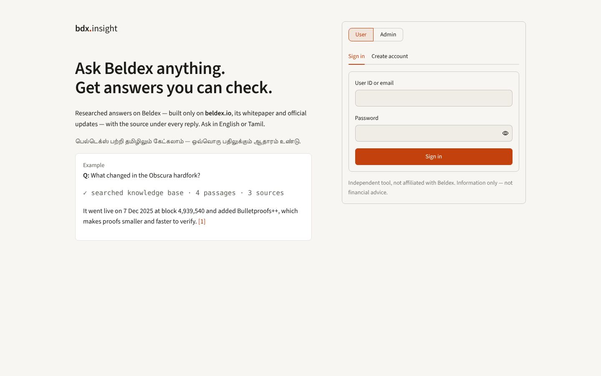
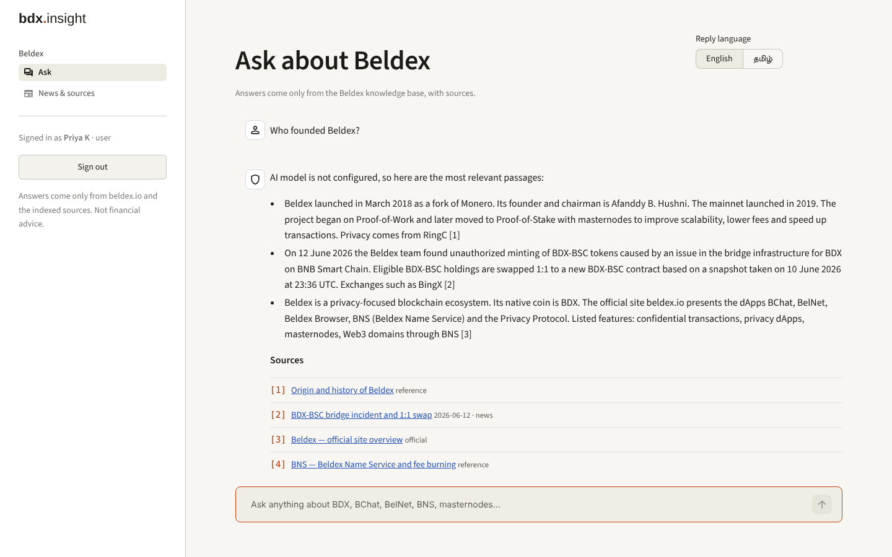
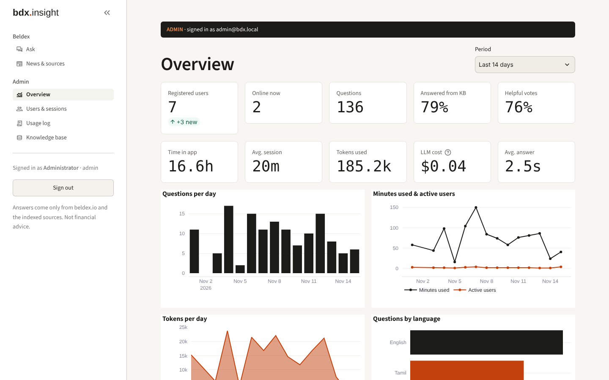
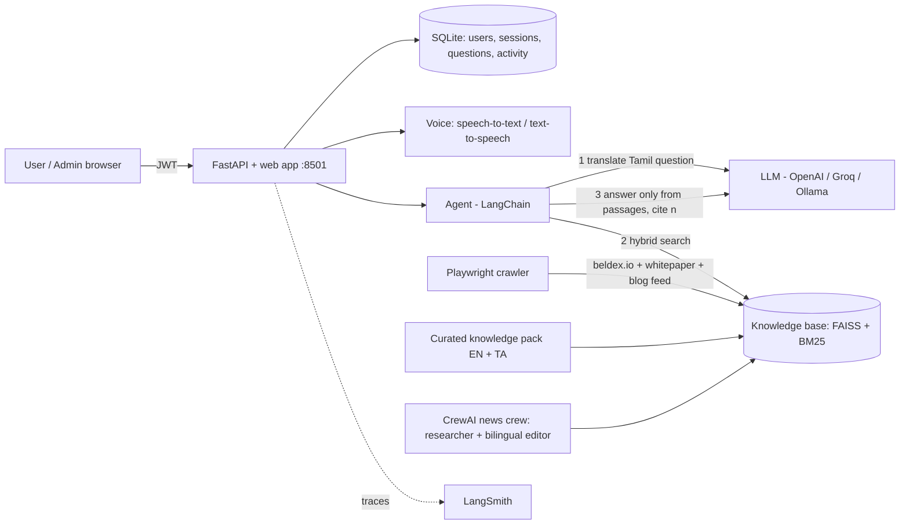

# Beldex AI — bilingual (English / தமிழ்) crypto assistant with an admin dashboard

**Live demo:** https://beldex.sathishsakthivel.tech

People sign in and ask anything about **Beldex (BDX)** and crypto basics — by typing or by **voice** — in **English or Tamil**. The AI agent answers **only from its own knowledge base** (beldex.io, the whitepaper, official updates and a curated crypto guide) and shows the **sources under every answer**. Admins get a separate console that shows who signed in, how long they stayed, what they asked, and how many tokens, how much cost and CPU each question used.



> **தமிழில் சுருக்கம்:** பயனர்கள் login செய்து Beldex, Bitcoin, blockchain, stablecoin போன்றவற்றைப் பற்றி தமிழிலோ ஆங்கிலத்திலோ — எழுத்தாகவோ குரலாகவோ — கேட்கலாம். AI agent தன் அறிவுத் தளத்தில் உள்ள தகவல்களை மட்டுமே பயன்படுத்தி பதில் சொல்லும்; ஒவ்வொரு பதிலுக்கும் கீழே ஆதாரம் (source link) காட்டும். Admin-க்கு தனி login உண்டு — யார் login செய்தார்கள், எவ்வளவு நேரம், என்ன கேட்டார்கள், எவ்வளவு tokens / செலவு / CPU ஆனது என்பதை dashboard-இல் பார்க்கலாம்.

---

## What it does

| For users | For admins |
|---|---|
| Separate **User** and **Admin** sign-in; sign-up asks only first name, last name, email, password (live validation, email-taken check) | **Overview:** users, online now, questions, voice share, time in app, tokens, cost, answer speed, server CPU/RAM, busiest hours (IST) |
| Ask in English or தமிழ் — by text or **voice** (speech-to-text in, spoken answer out) | **Users & sessions:** every person, every sign-in (IP, device, minutes), every question with its sources; suspend / reactivate / promote |
| Short, clear answers: bold summary, key points, "why it matters", numbered sources with links and dates | **Questions log:** filter by user, language, text/voice, answered or not; download CSV |
| Suggested follow-up questions and topic shortcuts (crypto, blockchain, Bitcoin, stablecoin, Nexus safety…) | **Unanswered questions** list — shows what to add to the knowledge base next |
| **Beldex Academy** — short lessons from "what is crypto" to masternodes | **Knowledge base:** every source, one-click refresh (Playwright crawl + re-index + news digest) |
| News & updates written by an AI news crew | Feedback (👍/👎) on each answer |




### What the knowledge base covers
- **Crypto basics:** cryptocurrency, blockchain and its purpose, how a transaction works, Bitcoin, Ethereum, Proof-of-Work vs Proof-of-Stake, wallets, exchanges (CEX/DEX), **stablecoins**, altcoins and tokens, privacy coins, market cap, common scams.
- **Beldex:** BDX at a glance, uses, masternodes and staking, BChat, BelNet, Beldex Browser, BNS, privacy protocol and bridge, hard forks, supply and burns, how to buy, risks, the 2026 roadmap, glossary.
- **Nexus (nexus.vin):** what it says it offers, plus the published warnings about it and what to check before using any staking platform. Nexus is not part of the Beldex project.
- Tamil explainers for the main topics. Everything has a source link.

---

## How it works



**Staying inside our own knowledge:** the agent may use only the numbered passages it retrieved. If they do not answer the question, it says so instead of guessing (tested in `tests/test_api.py`). Off-topic questions (weather, sports…) are politely refused.

---

## Concepts used, and why

| Concept | Used for | Why this one |
|---|---|---|
| **FastAPI** | Sign-in, the agent endpoint, voice, admin API (`/docs` has the full API) | Fast, typed, auto-documented; the web app and any future mobile app share one backend |
| **Web app (HTML/CSS/JS + Chart.js)** | Sign-in/up, chat, Academy and admin console, served by FastAPI | Full control over design and branding (own logo, favicon, animations); stays signed in after refresh |
| **LangChain** | Prompts, LLM calls, text splitting, retrievers | Standard RAG building blocks; switching LLM provider is one line in `.env` |
| **Vector DB — FAISS** | Meaning-based search, also matches Tamil questions to English passages | Runs as files in `data/index`, no extra server. Qdrant is the next step if the data grows |
| **BM25 (keyword search)** | Combined with FAISS (hybrid search); also works with no API key | Catches exact names like "BChat" or "BNS" that embeddings can miss |
| **Knowledge RAG** | Grounded answers with `[n]` citations | Keeps answers inside our own sources |
| **AI agent** | translate → search → answer → check citations → suggest follow-ups | Shown to the user as "How this answer was made" |
| **CrewAI** | News crew: *researcher* + *bilingual editor* write the digest | Two roles fit a simple sequential crew |
| **Playwright** | Crawls beldex.io and its sub-sites like a real browser | The official site renders with JavaScript, so a plain HTTP fetch misses content |
| **OpenAI speech** | `gpt-4o-mini-transcribe` (voice in) and `gpt-4o-mini-tts` (voice out); browser speech as fallback | Works for Tamil and English; answers are cached so repeats cost nothing |
| **LangSmith** | Optional tracing of every LLM call | Debug and cost checks (`LANGSMITH_TRACING=true`) |
| **Docker + Traefik** | One container on the VPS, HTTPS on our own sub-domain | Same setup as the other live apps on the server |
| **SQLAlchemy + SQLite** | Users, sessions, questions, activity, crawl runs | Zero setup; set `DATABASE_URL` for Postgres later |
| **bcrypt + JWT** | Password hashing and login tokens with roles | Never stores plain passwords |
| **psutil** | Per-question CPU time and memory; server CPU/RAM/disk | The "resources used" numbers in the admin dashboard |

**Left out on purpose (possible next steps):** AutoGen (CrewAI already covers multi-agent), Neo4j (useful once there are hundreds of linked entities), fine-tuning a small model (point `OPENAI_BASE_URL` at local **Ollama** instead for zero API cost).

---

## Project structure

```
beldex/
├── app/
│   ├── api.py              # FastAPI: auth, /chat, voice, admin endpoints, serves web/
│   ├── db.py               # tables: users, sessions, queries, activity, knowledge_runs
│   ├── security.py         # bcrypt + JWT, user/admin guards
│   ├── metrics.py          # latency, CPU time, memory per question; server snapshot
│   ├── voice.py            # speech-to-text and text-to-speech (with cache)
│   ├── config.py           # reads .env
│   ├── rag/
│   │   ├── knowledge_pack.json   # curated crypto + Beldex + Nexus knowledge (EN + TA, with sources)
│   │   ├── seed_knowledge.json   # starter Beldex facts
│   │   ├── knowledge.py    # load → split → FAISS + BM25 hybrid index
│   │   ├── chain.py        # the agent (translate → retrieve → grounded answer → follow-ups)
│   │   ├── crawler.py      # Playwright crawler for beldex.io + blog feed
│   │   └── llm.py          # LangChain model + embeddings factory
│   └── agents/news_crew.py # CrewAI researcher + bilingual editor
├── web/                    # index.html (sign-in/up), app.html (chat), learn.html (Academy), admin.html, css, js, logo
├── scripts/seed_demo.py    # optional demo users and usage for presentations
├── tests/test_api.py       # pytest: sign-up, grounding, Tamil, off-topic, roles, voice, suspend, logout
├── deploy/connect_domain_traefik.sh   # VPS + Traefik + HTTPS in one command
├── run_mac.sh              # one command: venv + packages + start (Mac)
├── Dockerfile, docker-compose.yml, start.sh
└── .env.example
```

---

## Run it on your Mac (VS Code) — step by step

**1. Get the code.** Open VS Code → **Terminal → New Terminal**:
```bash
cd ~/Downloads
git clone https://github.com/sathishvarun/SE-B12.git     # first time only (later: cd SE-B12 && git pull)
cd SE-B12/beldex
code .                                                  # opens the project in VS Code
```

**2. Create and activate a virtual environment** (use Python 3.12 or 3.13 for full CrewAI support):
```bash
python3 -m venv .venv
source .venv/bin/activate        # your prompt now starts with (.venv)
```
In VS Code press `Cmd+Shift+P` → **Python: Select Interpreter** → pick `.venv`.

**3. Install the packages** (3–6 minutes the first time):
```bash
python -m pip install --upgrade pip
python -m pip install -r requirements.txt
python -m playwright install chromium
```

**4. Create `.env` and paste your keys:**
```bash
cp .env.example .env
python3 -c "import secrets; print(secrets.token_hex(32))"   # copy the long text it prints
```
Open `.env` in VS Code and fill in:
- `OPENAI_API_KEY=` → your key from https://platform.openai.com/api-keys
- `JWT_SECRET=` → the long text you just printed
- `ADMIN_EMAIL=` and `ADMIN_PASSWORD=` → your admin login (created on the first start)

**5. Start the app:**
```bash
bash start.sh
```
Open **http://localhost:8501** (API docs: http://localhost:8501/docs). Stop with `Ctrl+C`.

*Shortcut:* steps 2, 3 and 5 are all done by `bash run_mac.sh`.

**6. First things to do:**
1. Click **Admin**, sign in with your `ADMIN_EMAIL` / `ADMIN_PASSWORD`.
2. Go to **Knowledge base → Refresh knowledge** (2–5 minutes: crawl + re-index + news).
3. Sign out, choose **User → Create account**, and ask a question in Tamil or by voice.
4. *(Optional, for a sales demo)* `python scripts/seed_demo.py` adds 6 demo users; remove them with `python scripts/seed_demo.py --clear`.

**7. Run the tests:** `pytest -q`

**Or with Docker:** `docker compose up --build` → http://localhost:8501

---

## Put it live (Hostinger VPS with Traefik)

1. **DNS:** in the domain's DNS panel add an **A record**: Name `beldex` → Value `YOUR_VPS_IP`.
2. **Open a terminal on the VPS:** hPanel → **VPS → Browser terminal** (or `ssh root@YOUR_VPS_IP`).
3. **Get only this project folder from GitHub:**
   ```bash
   git clone --depth 1 --filter=blob:none --sparse https://github.com/sathishvarun/SE-B12.git ~/beldex-app
   cd ~/beldex-app && git sparse-checkout set beldex
   cd ~/beldex-app/beldex
   ```
4. **Create `.env`** (use a strong admin password and a new JWT secret for the live server):
   ```bash
   cp .env.example .env
   python3 -c "import secrets; print(secrets.token_hex(32))"
   nano .env        # paste OPENAI_API_KEY, JWT_SECRET, ADMIN_EMAIL, ADMIN_PASSWORD; save with Ctrl+O, Enter, Ctrl+X
   ```
5. **Start it with HTTPS:**
   ```bash
   bash deploy/connect_domain_traefik.sh beldex.sathishsakthivel.tech
   ```
   It finds Traefik, builds the image, starts the `beldex-ai` container and prints the live link.
6. **Share** https://beldex.sathishsakthivel.tech — users create their own accounts; you sign in through the **Admin** tab.

**Update later:** `cd ~/beldex-app/beldex && git pull && bash deploy/connect_domain_traefik.sh beldex.sathishsakthivel.tech`. Users and history in `data/` are kept.

**Useful commands on the VPS:** `docker logs -f beldex-ai` (live log) · `docker restart beldex-ai` · `docker ps` (is it running?)

---

## What the admin numbers mean
- **Time used** = from sign-in until the person's last action in that session (every click or question extends it; signing out closes it). **Online** = active in the last 5 minutes.
- **Tokens / cost** = what the LLM reported for that question × the prices in `.env`.
- **CPU time / memory** = measured on the API process while answering. **Server** = whole-machine CPU, RAM and disk.
- **Answered from KB** = share of questions the knowledge base could answer; the rest are listed so you know what to add.

## Good to know
- You stay signed in after a refresh (12 hours by default, `JWT_HOURS`). Passwords need 8+ characters with at least one letter and one number.
- Answers are information only, not financial advice. This tool is independent and not affiliated with Beldex or Nexus.
- Never commit `.env` — it is already in `.gitignore`.
